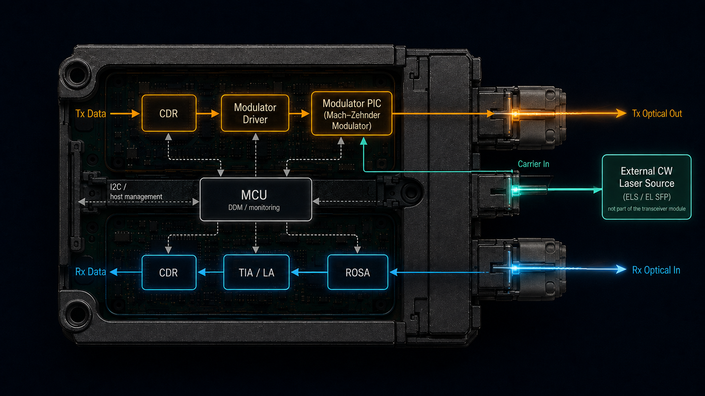

# SysML Optical Transceiver



_Project ambition: a complete optical-transceiver golden thread from system model to implementation evidence and application context. The current baseline remains deliberately transmitter-first._

A SysML v2 reference project for a silicon-photonics optical transceiver, developed with the Elan8 Method.

The initial scope is deliberately transmitter-first. The project begins with the module boundary and external interfaces, then develops one electrical-to-optical golden thread through requirements, architecture, analysis, verification, PIC projection, and generated layout evidence.

## Current increment

**EI-002 — Define the transmitter behavior and logical architecture**

Engineering question:

> How is electrical data converted to modulated optical output?

The model now adds one transmitter-first vertical slice to the EI-001 boundary: NRZ/OOK encoding, electrical drive generation, Mach–Zehnder carrier modulation, and output fibre coupling. The selected architecture allocates these responsibilities to transmit electronics, a modulator, and a replaceable output coupler. Quantitative optical loss and margin remain deliberately deferred to EI-003.

## Repository map

| Path                             | Purpose                                                                   |
| -------------------------------- | ------------------------------------------------------------------------- |
| `model/00_project/`              | Elan8 Method tailoring                                                    |
| `model/10_purpose/`              | Stakeholders, needs, requirements, and operational context                |
| `model/20_behavior/`             | Transmit scenario and later receive/control behavior                      |
| `model/30_architecture/`         | Selected system usage and later architecture                              |
| `model/40_analysis/`             | Executable analyses, starting in EI-003                                   |
| `model/50_verification/`         | Verification intent and evidence links                                    |
| `model/60_views/`                | Views over the authoritative model graph                                  |
| `model/90_library/`              | Project-local import hub                                                  |
| `library/photonics/`             | Experimental reusable photonics definitions                               |
| `PROJECT_PLAN.md`                | Tracked delivery plan and baseline strategy                               |
| `docs/REFERENCE_ARCHITECTURE.md` | Industry-generic transceiver reference architecture, mapped to this model |

## Validation

Requires a Spec42 executable with its managed method and domain libraries installed:

```powershell
powershell -ExecutionPolicy Bypass -File .\scripts\validate.ps1
```

An executable override is supported through `SPEC42_EXE`. No project-specific method or domain library configuration is required.

## Scope boundary

The continuous-wave laser is external to the initial module. Generated layout will initially target semantic connectivity and an L1 generic-PDK layout skeleton; it is not a foundry-ready implementation.
