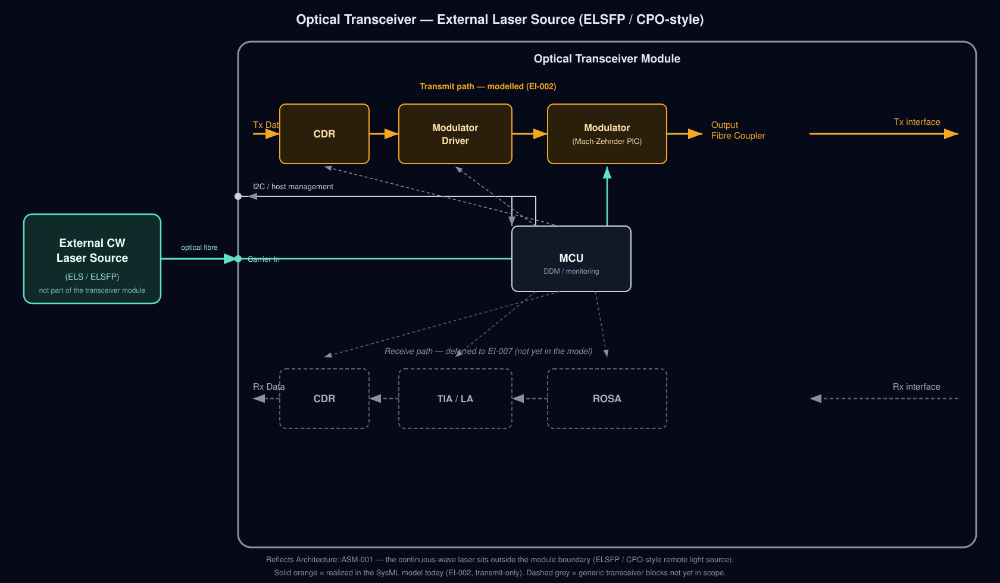

# Reference Architecture

This document describes how optical transceiver modules are built in industry
practice, independent of any single vendor, and maps that reference architecture
onto the parts, ports, and behaviors defined in this SysML v2 model. It exists so
that architecture decisions in `model/30_architecture/` can be checked against
real designs instead of drifting toward whatever diagram was most recently on
hand.

This is descriptive background, not the system model. The SysML model in
`model/` remains the single source of truth for what this project actually
specifies; this document explains the industry context that decisions like
`ADR-001` and `ASM-001` are grounded in.

## Scope note

The description below is intentionally generic — it describes the block-level
architecture common across pluggable optical modules (SFP/QSFP/OSFP-class) and
external-laser/co-packaged designs, not a specific product. Where a widely used
vendor or industry term applies to a block, it is noted in parentheses so the
model's abstract naming can be cross-referenced against datasheets and MSAs
(Multi-Source Agreements) if needed later.

## Transmit path

| Function                         | What it does                                                                                        | Common industry term(s)                                                                                                                                                                                                                                                                                                                |
| -------------------------------- | --------------------------------------------------------------------------------------------------- | -------------------------------------------------------------------------------------------------------------------------------------------------------------------------------------------------------------------------------------------------------------------------------------------------------------------------------------- |
| Data recovery / retiming         | Cleans up and re-times the incoming host electrical signal before it drives the optics              | CDR (Clock and Data Recovery), sometimes a retimer or gearbox chip                                                                                                                                                                                                                                                                     |
| Drive generation                 | Converts the retimed digital signal into the analog drive needed by the optical source or modulator | Laser Diode Driver (LDD) for a directly modulated laser; Modulator Driver for an external-modulator design                                                                                                                                                                                                                             |
| Electrical-to-optical conversion | Turns electrical drive into modulated light                                                         | TOSA (Transmitter Optical Subassembly) — in traditional pluggables this packages the laser itself (DFB, DML, or EML) together with drive optics; in external-laser/PIC designs this role is played by a modulator (commonly a Mach-Zehnder Modulator, MZM, or a ring modulator) on the photonic chip, with no laser inside the package |
| Output coupling                  | Gets the modulated light from the chip/package onto the fibre                                       | Fibre coupler / lens assembly, often folded into the TOSA in traditional modules                                                                                                                                                                                                                                                       |

Traditional pluggable modules (most SFP+/QSFP28/QSFP-DD optics on the market
today) integrate the laser inside the TOSA — the laser, its thermal control, and
the modulation element all live inside the transceiver case.

## Receive path

| Function                         | What it does                                                   | Common industry term(s)                                                                                                                  |
| -------------------------------- | -------------------------------------------------------------- | ---------------------------------------------------------------------------------------------------------------------------------------- |
| Optical-to-electrical conversion | Converts incoming light to a current signal                    | ROSA (Receiver Optical Subassembly) — contains a photodetector (PIN photodiode for short reach, APD for longer reach/higher sensitivity) |
| Current-to-voltage amplification | Converts the small photodiode current into a usable voltage    | TIA (Trans-Impedance Amplifier)                                                                                                          |
| Amplitude normalization          | Normalizes varying signal amplitude into a stable output level | LA (Limiting Amplifier) — TIA and LA are frequently combined into one "TIA/LA" chip                                                      |
| Clock and data recovery          | Recovers a clean clock and re-times data for the host          | CDR, mirroring the transmit-side block                                                                                                   |

In many current-generation modules (400G/800G-class), the transmit CDR, receive
CDR, and driver/TIA functions are consolidated into a single DSP ASIC rather than
discrete chips per block — the functional decomposition below still applies, the
physical chip count does not always match it 1:1.

## Management

| Function           | What it does                                                                                                          | Common industry term(s)                                                                                                             |
| ------------------ | --------------------------------------------------------------------------------------------------------------------- | ----------------------------------------------------------------------------------------------------------------------------------- |
| Module supervision | Monitors temperature, supply voltage, bias current, and received/transmitted optical power; sequences module bring-up | MCU (microcontroller), running Digital Diagnostic Monitoring / Digital Optical Monitoring (DDM/DOM) firmware                        |
| Host communication | Exposes monitoring data and configuration to the host system                                                          | I2C, per the register layout defined in industry specs such as SFF-8472 (DDM) and SFF-8636 / CMIS (QSFP-class management interface) |

## Power and thermal (traditional integrated-laser modules)

Modules with an integrated laser typically also carry a TEC (thermoelectric
cooler) to stabilize laser wavelength and DC-DC conversion to derive the
voltages each block needs from the host power rail. These are physical/thermal
concerns rather than data-path concerns, and are out of scope for the functional
blocks above.

## External-laser and co-packaged architectures

A growing alternative, especially for coherent and AI-datacenter-fabric optics,
moves the laser out of the transceiver entirely:

- **ELSFP (External Laser SFP)** — an architecture and connector convention
  where the pluggable module has no laser inside it; a remote laser module
  supplies continuous-wave light over a separate fibre. This removes laser heat
  and one of the more failure-prone components from the pluggable itself.
- **CPO (Co-Packaged Optics)** — takes the same idea further by tightly
  integrating photonic engines with switch silicon, with the laser sourced from
  an external light source (sometimes called an ELS, "External Light Source")
  that can be shared across many optical engines rather than duplicated per
  port. Industry activity here includes OIF CPO framework work and multiple
  switch/silicon-photonics vendors' CPO programs.

Both approaches trade a simpler, cooler, more serviceable pluggable/engine for
added system-level complexity: an external light source becomes a shared
dependency with its own fibre distribution and failure domain, and the laser is
no longer a per-module field-replaceable unit.

## Mapping to this model

| Reference architecture block | This model                                                                                          | Status                                                                                           |
| ---------------------------- | --------------------------------------------------------------------------------------------------- | ------------------------------------------------------------------------------------------------ |
| Host Tx data boundary        | `TransceiverContext::OpticalTransceiverModule::electricalTxDataInput`                               | Modelled (EI-001)                                                                                |
| CDR + driver (Tx)            | `Architecture::TransmitElectronics` (`encodeData` + `generateDrive` actions)                        | Modelled (EI-002) — combined into one logical part; not yet split into discrete CDR/driver parts |
| TOSA laser                   | N/A — laser is explicitly external, see `ASM-001`                                                   | Out of scope by design (ELSFP/CPO-style)                                                         |
| Modulator (PIC)              | `Architecture::MachZehnderModulator`                                                                | Modelled (EI-002), per `ADR-001`                                                                 |
| Output coupling              | `Architecture::OutputFibreCoupler`                                                                  | Modelled (EI-002)                                                                                |
| External CW laser source     | `TransceiverContext::ContinuousWaveLaser` (external actor)                                          | Modelled as a boundary actor (EI-001); not an internal part                                      |
| ROSA / TIA-LA / Rx CDR       | —                                                                                                   | Deferred (EI-007, "Can the receive path recover usable electrical data?")                        |
| MCU / DDM / I2C management   | `TransceiverContext::ManagementController` + `ManagementPort` (external actor + boundary port only) | Boundary contract modelled (EI-001); internal MCU realization deferred                           |
| Power / thermal              | `TransceiverContext::ExternalPowerSource` + `PowerRailPort`                                         | Boundary contract modelled (EI-001); internal regulation/TEC out of current scope                |

See `PROJECT_PLAN.md` for the full engineering-increment roadmap and
`docs/ELAN8_METHOD_TOUR.md` for the per-increment review record.

## Further reading (industry-generic, non-proprietary)

- IEEE 802.3 — Ethernet PHY specifications referenced by most pluggable MSAs.
- SFF-8472 — Diagnostic Monitoring Interface for optical transceivers (DDM/DOM).
- SFF-8636 / CMIS — QSFP-class management interface specifications.
- QSFP-DD MSA, OSFP MSA — mechanical/electrical multi-source agreements for
  current-generation pluggable form factors.
- OIF (Optical Internetworking Forum) — CPO and coherent-optics framework work,
  including external-laser-source interface efforts.
